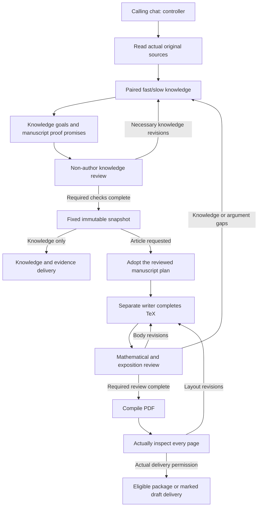

# Pure Math Survey 2.1.0

**2.4.1 development:** [Guide](docs/development/v2.4.1/DEVELOPMENT_GUIDE.zh-CN.md), [staged workflow](docs/development/v2.4.1/PR_WORKFLOW.zh-CN.md), and [sole development state](docs/development/v2.4.1/DEVELOPMENT_STATE.yaml). PR-01 establishes the development contract and navigation only; the functionality below remains 2.1.0 and does not imply that 2.4.1 is implemented or released.

[简体中文](README.md) | **English**

Software is **2.1.0**, knowledge/snapshot schema **2.0.0**, output/review schema **2.2.0**, and the current editorial policy is **four-modes-2026-10-15-r5**. The four development stages and CI race fix are merged; completed comparison-theorem mathematical acceptance is reused within its verified scope. See [release notes and validation limits](docs/releases/v2.1.0.md) and [stage status](docs/development/STATUS.md). [GitHub Releases](https://github.com/ZhiyaoXiongMath/Pure-Math-Survey/releases) determines publication status; release-preparation documentation or RELEASE_READY does not mean publication has occurred. [Historical preview notes](docs/r4/development-status.md) preserve the earlier scope.

For authors organizing mathematical literature, maintaining traceable knowledge, and writing English surveys, lectures or research drafts.

## Modes

| Mode | Task and structure |
|---|---|
| **Minimal** | Understand complete results and decisive reasons concisely; no abstract, exactly Main Results / Key Mathematical Ingredients / Connecting the Ingredients, all complete principals in section one. |
| **Thematic** | Explore topical questions, genuine methods and synthesis under comparable conditions; no abstract, precise questions and representative complete results first. |
| **Lecture** | Reproduce constructions, calculations and proofs; no abstract, a full goal theorem and faithful route guide teaching derivations. |
| **Paper** | Organize research materials; concise abstract and full Introduction, accurate contribution position and arguments; visibly DRAFT_UNVERIFIED by default. |

**Minimal + integrated** defaults only when an article is requested without a mode. Five views—integrated, foundations, results, methods, boundaries—change emphasis, not facts or duties; generate only requested counts. Knowledge-only is not a fifth article mode and produces no manuscript.

Known results cannot be called original. Formal Paper research delivery requires real authorization, contribution verification and complete proofs; unverified drafts cannot be formally packaged. See [mode contracts](skills/pure-math-survey/references/editions.md).

Source access, scoped original-text reading, rehashable bytes and original-byte redistribution are separate recorded facts. Private originals stay outside public project inputs; retained originals require explicit public visibility and actual redistribution authorization before freeze. Online/private reading may support knowledge READY while bytes or redistribution remain UNVERIFIED/REJECTED. Knowledge READY does not confer Paper research eligibility; a visibly marked Paper Draft can be previewed. See [source evidence](skills/pure-math-survey/references/research-and-evidence.md).

## Install and verify

For a formal installation, select the non-prerelease `v2.1.0` in [Releases](https://github.com/ZhiyaoXiongMath/Pure-Math-Survey/releases) and download its complete `pure-math-survey-2.1.0.zip` and `pure-math-survey-2.1.0.zip.sha256`. If that formal version or either asset is absent, formal publication is incomplete. `v2.1.0-r4-preview.1` remains a historical prerelease and cannot substitute for the formal version. The automatically generated Source code ZIP is not the installation ZIP.

With Python 3.10+, run these commands in a new directory containing both assets. Here `python` means that interpreter; substitute `python3` if that is its command name on your system:

```sh
python -c "import hashlib,pathlib; p=pathlib.Path('pure-math-survey-2.1.0.zip'); expected=pathlib.Path(str(p)+'.sha256').read_text().split()[0]; actual=hashlib.sha256(p.read_bytes()).hexdigest(); print('SHA-256 OK' if actual == expected else 'SHA-256 MISMATCH'); raise SystemExit(0 if actual == expected else 1)"
python -m zipfile -t pure-math-survey-2.1.0.zip
python -m zipfile -e pure-math-survey-2.1.0.zip pms-install
python -B pms-install/pure-math-survey/scripts/survey.py --version --json
```

The first two commands should report `SHA-256 OK` and `Done testing`; extract and use the package only after successful checks. The last command should return JSON with `status: OK` and `artifacts` containing `version: 2.1.0`, `schema_version: 2.0.0`, `output_schema_version: 2.2.0`, and `editorial_policy: four-modes-2026-10-15-r5`. Then copy the whole extracted `pure-math-survey/` into the host skills directory (for example Codex's `~/.codex/skills/`), retaining references, scripts and assets. Preserve an existing installation before replacing it.

Before formal assets are published, a checked-out candidate source tree can also build a local verification package. From its repository root, run the following, then use the same verification commands above. This verifies a candidate and does not establish publication:

```sh
python -B skills/pure-math-survey/scripts/package_release.py --output ../pms-install-check/pure-math-survey-2.1.0.zip
cd ../pms-install-check
```

The host needs work-chat creation/read/wait/task-message tools and available `gpt-6-astra / ultra`. Scripts use Python 3.10+ standard library; PDFs need pdfLaTeX, BibTeX, the style's TeX packages and Poppler. Missing capabilities are reported; see [build requirements](skills/pure-math-survey/references/layout-and-build.md).

## Start prompts

In a new chat send the shared authorization together with one prompt below. Replace brackets with your topic, audience, sources and project. These describe **requests and expected delivery, not completed mathematical examples**.

```text
This chat is the controller. I authorize gpt-6-astra / ultra work chats within [project path]
for sources, fast/slow knowledge, writing and non-author review, and task/continuation/revision/
stop messages to them; read their results. Read the complete installed skill, specified sources
and this project; write only within the project.
```

**Minimal**

```text
Use $pure-math-survey with [source files/URLs] for [topic and scope], for readers with
[background]. Write one English Minimal, view=integrated, with complete principals,
necessary ingredients and decisive reasons.
```

Expected: editable TeX, inspected PDF, and a rebuildable package when delivery permission passes.

**Thematic**

```text
Use $pure-math-survey with [source files/URLs] for [topic and scope], for readers with
[background]. Write one English Thematic around real questions/methods and synthesize
results under comparable conditions.
```

Expected: thematic TeX/PDF with actual source/review evidence, and an eligible rebuildable package.

**Lecture**

```text
Use $pure-math-survey with [source files/URLs] to teach [topic and scope], for readers with
[background]. Write one English Lecture fully developing [specified constructions,
calculations or proof steps], with disclosed external inputs.
```

Expected: lecture TeX/PDF fulfilling the promised derivations, and an eligible rebuildable package.

**Paper**

```text
Use $pure-math-survey with [my research materials and original sources] for [problem and scope],
for readers with [background]. Write one English Paper working draft; distinguish known,
candidate and unverified content, invent no originality, and retain DRAFT_UNVERIFIED.
```

Expected: visibly marked draft TeX and an allowed preview PDF; no formal article package without research-delivery verification.

**Knowledge only**

```text
Use $pure-math-survey to read [source files/URLs] and build knowledge for [topic and scope],
for readers with [background]. Explain results, conditions, fast routes and slow derivations;
do not produce an article or PDF.
```

Expected: overview, editable nodes, source/review records and explicit gaps. Authorization comes from your actual instruction and is reused within scope; users do not manually fill review JSON.

## How it runs

The calling chat is the controller and keeps its model. It dispatches real work chats, reads actual files and is the sole canonical knowledge integration writer. Fast passages explain goals, inputs, operations and uses; slow passages perform derivations and precise external-theorem applications. Non-authors check the requested proof promises.



Plans/proof promises are fixed before output-specific knowledge review; the diagram's manuscript plan implements that reviewed design. Freezing fixes bytes, not readiness. `prepare` supplies materials/scaffolding; writers still author the body. Compilation, rendering and hashes replace neither mathematical checking nor all-page observation. Unmet conditions are reported, not waived.

Knowledge delivers overview/nodes/sources/evidence. Articles add plan, outline, `manuscript/main.tex`, fixed materials, `build/main.pdf` and review records. New sources/corrections return to knowledge review before a new snapshot, preserving old files. Specify each additional mode, audience and count: a snapshot may be shared, with separate writing/review.

The PR02 candidate supplies pending `review template` checks for applicable canonical statements and dependencies, aggregate `review validate` diagnostics, and staged `review accept` validation of final candidate bytes with rollback on failure. Acceptance still requires a separate freeze and explicit snapshot adoption. See [review handoff](skills/pure-math-survey/references/proofs-and-boundaries.md#review-handoff-and-candidate-acceptance) and the [development contract](docs/development/CONTRACT.md).

This version supports only editorial policy `four-modes-2026-10-15-r5`; old/unknown output contracts are rejected without file modification. See [entrypoint](skills/pure-math-survey/SKILL.md) and [validation limits](skills/pure-math-survey/references/validation.md). AI review is not external peer review or originality certification. Code/instructions/templates use [MIT License](LICENSE); mathematical materials and third-party sources retain their rights.

## Verified scope

The merged software baseline passed regression, isolated-installation and neutral TeX smoke checks on Linux Python 3.10, Linux Python 3.12 and Windows Python 3.12; see [actual main CI](https://github.com/ZhiyaoXiongMath/Pure-Math-Survey/actions/runs/38846120380). Release-preparation changes additionally require the same three checks and independent non-author review for their current HEAD.

The completed real comparison-theorem task covers one frozen KB, four modes with 50 manuscript/draft pages, and independent mathematical and all-page review. Minimal, Thematic and Lecture were packaged under their respective delivery permissions; known-result Paper stays `DRAFT_UNVERIFIED`, with eligibility and formal delivery rejected as expected. This acceptance retains four process/bookkeeping exceptions and unverified scope; it is not an unqualified protocol PASS. It does not turn historical E01–E05 failures or pauses into an all-cases pass, or establish originality, formal original-research eligibility, external human academic peer review, real student learning outcomes or cross-platform mathematical reconstruction. Private sources and original acceptance artifacts are excluded from public software distribution.
