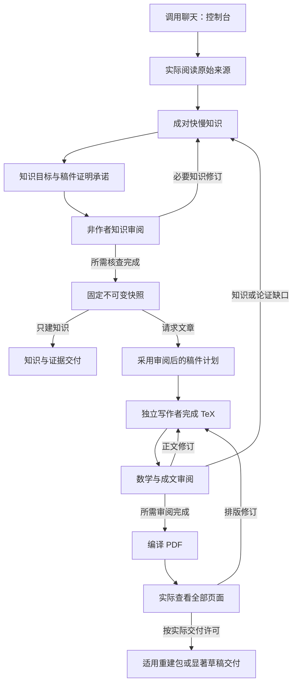

# Pure Math Survey — 预览版

**简体中文** | [English](README.en.md)

当前为 `v2.1.0-r4-preview.1` 预览版（软件 2.1.0），数学端到端验收仍在验证；[阶段状态](docs/development/STATUS.md)记录已核实的开发阶段；[历史预览记录](docs/r4/development-status.md)保留此前范围。

面向整理数学文献、维护可追溯知识库、撰写英文综述、讲义或研究草稿的作者。

## 模式

| 模式 | 适合的任务与结构 |
|---|---|
| **Minimal** | 精炼地理解完整结果与决定性理由；无摘要，严格 Main Results / Key Mathematical Ingredients / Connecting the Ingredients 三节，全部完整主结果在第一节。 |
| **Thematic** | 理解专题问题、真实方法及可比条件下的综合；无摘要，首节给出准确问题与代表性完整结果。 |
| **Lecture** | 学会复现构造、计算与证明；无摘要，完整目标定理与忠实路线引导后续教学推导。 |
| **Paper** | 整理研究材料；有简洁摘要与完整 Introduction，准确定位贡献并论证，默认显著 DRAFT_UNVERIFIED 草稿。 |

仅在请求文章且未指定模式时，默认 **Minimal + integrated**。五种 view：integrated、foundations、results、methods、boundaries，改变侧重点而不改变事实或模式责任；只生成用户请求的数量。只建知识不是第五种文章模式，也不会附带生成稿件。

已知结果不能假称原创。Paper 正式研究交付需要真实授权、贡献核查和完整证明；未验证草稿不能正式打包。[模式契约](skills/pure-math-survey/references/editions.md)提供细节。

原文访问、实际阅读范围、可重哈希字节与原文字节再分发权限分别据实记录。私人原文应保留在公开项目之外；项目内原文须明确 public 与真实再分发授权才能 freeze。在线／私有阅读可支持知识 READY，同时字节或再分发仍为 UNVERIFIED／REJECTED。知识 READY 不授予 Paper 正式研究资格；显著标识的 Paper Draft 可预览。见[来源证据](skills/pure-math-survey/references/research-and-evidence.md)。

## 启动提示

先在 [Release 页面](https://github.com/ZhiyaoXiongMath/Pure-Math-Survey/releases/tag/v2.1.0-r4-preview.1)下载完整 `pure-math-survey-2.1.0.zip` 及 `pure-math-survey-2.1.0.zip.sha256`，核对后把解压出的整个 `pure-math-survey/` 放入宿主 skill 目录（如 Codex 的 `~/.codex/skills/`），保留 references、scripts、assets。自动生成的 Source code ZIP 不是安装 ZIP。

宿主需支持创建、读取、等待和发送任务给工作聊天，并提供 `gpt-6-astra / ultra`；脚本使用 Python 3.10+ 标准库，PDF 另需 pdfLaTeX、BibTeX、样式所需 TeX 包和 Poppler。缺少能力时报告具体阻碍，见[构建要求](skills/pure-math-survey/references/layout-and-build.md)。

新聊天中，把共用授权和下面一条提示一起发送，将方括号换成自己的主题、读者、来源和项目路径。以下是**请求与预期交付说明，不是本次已完成的数学样稿**。

```text
本聊天作为控制台。我授权在[项目路径]内创建 gpt-6-astra / ultra 工作聊天，
负责来源、快慢知识、写作和非作者审阅；授权向它们发送任务、继续、修订、
停止指令并读取结果。允许读取完整安装 skill、指定来源和本项目，写入仅限本项目。
```

**Minimal**

```text
使用 $pure-math-survey，基于[来源文件或URL]研究[主题及范围]，面向[读者基础]，
写一份英文 Minimal，view=integrated；完整给出主结果、必要支点和决定性理由。
```

预期：可编辑 TeX、经检查的 PDF，交付许可通过时附可重建包。

**Thematic**

```text
使用 $pure-math-survey，基于[来源文件或URL]讨论[专题及范围]，面向[读者基础]，
写一份英文 Thematic；按真实问题和方法组织，并在可比条件下综合结果。
```

预期：专题稿的 TeX、PDF，以及实际来源与审阅证据；合格时附可重建包。

**Lecture**

```text
使用 $pure-math-survey，基于[来源文件或URL]讲解[主题及范围]，面向[读者基础]，
写一份英文 Lecture；完整展开[指定构造、计算或证明步骤]，说明外部输入。
```

预期：兑现所承诺推导的讲义 TeX、PDF，以及合格时的可重建包。

**Paper**

```text
使用 $pure-math-survey，基于[我的研究材料及原始来源]整理[问题及范围]，
面向[读者基础]，写一份英文 Paper 工作草稿；准确区分已知、候选与未验证内容，
不要虚构原创性，保留 DRAFT_UNVERIFIED 标识。
```

预期：显著草稿 TeX 与允许的预览 PDF；未经研究交付核查不提供正式文章包。

**只建知识**

```text
使用 $pure-math-survey，阅读[来源文件或URL]，为[主题及范围]建立知识库，
面向[读者基础]解释结果、条件、快路线和慢推导；不要生成文章或 PDF。
```

预期：项目综览、可编辑知识节点、来源／审阅记录与明确缺口。授权来自你实际发送的指令；已有同范围的有效授权会复用，你不需要手填审阅 JSON。

## 怎么运行

调用聊天就是控制台，保留当前模型设置；它派发真实工作聊天、读取实际文件，并单写整合权威知识。快层解释目标、输入、关键操作和用途，慢层展开对应推导与外部定理接口；非作者核对所请求稿件的具体证明承诺。



计划和证明承诺会在输出相关知识审阅前明确；图中的“稿件计划”落实已审阅的设计。冻结只固定字节，不授予数学就绪；`prepare` 只生成固定材料和脚手架，写作者仍须实际成文。编译、渲染和哈希不能代替数学核查或逐页观察；条件不满足时说明阻碍，不降低标准放行。

知识交付包含综览、节点、来源和证据；文章另有计划、outline、`manuscript/main.tex`、固定材料、`build/main.pdf` 及审阅记录。新来源或纠正先回知识层核查，再形成新快照，旧文件保持不变。多输出分别指定模式、读者和数量，可以共享同一快照，但须独立写作与审阅。

PR02 候选的 `review template` 为实际适用 canonical 与依赖生成 pending 核查项；`review validate` 批量列出独立缺项；`review accept` 在项目内暂存并核对候选最终字节，失败时回滚。接收后仍须 freeze 和显式采用快照。实际接口见[审阅与接收](skills/pure-math-survey/references/proofs-and-boundaries.md#review-handoff-and-candidate-acceptance)，阶段边界见[开发合同](docs/development/CONTRACT.md)。

当前开发分支采用 `four-modes-2026-10-15-r5` 写作政策（软件与 schema 不变），仅支持该当前政策，旧／未知输出契约明确拒绝且原文件不改。更多说明见[完整入口](skills/pure-math-survey/SKILL.md)和[验证边界](skills/pure-math-survey/references/validation.md)。AI 审阅不等于外部同行评审或原创性认证。代码、指令和模板遵循 [MIT License](LICENSE)；数学材料及第三方来源保留各自权利。
